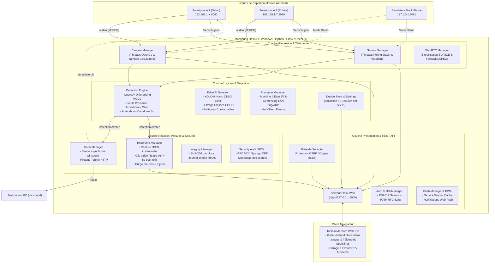

# Architecture Technique — SMART SECURITY MONITOR (TP4)

Ce document décrit l'architecture logicielle, les flux de données et l'organisation modulaire du système **SMART SECURITY MONITOR**.

---

## 1. Vue d'Ensemble du Système

Le système est conçu selon une architecture distribuée client-serveur IoT :
- **Monitoring Host (PC Windows)** : Point de convergence central hébergeant le serveur Flask, le moteur d'analyse vidéo OpenCV, le moteur d'inférence de détection multi-vectorielle, la sirène locale `winsound`, et le gestionnaire de preuves.
- **Nœuds Capteurs & Vidéo (Smartphones Android)** : Terminaux mobiles exécutant l'application *IP Webcam* sur le réseau local Wi-Fi, fournissant un flux vidéo MJPEG (`/video`) et des données télémétriques JSON (`/sensors.json`).
- **Simulateur Intégré (`mock_ipwebcam.py`)** : Nœud de simulation autonome capable d'émuler un smartphone complet pour la validation sans matériel physique.

---

## 2. Diagramme d'Architecture et Circulation des Données

---

## 3. Description Détaillée des Modules

### 3.1 `monitoring/camera_manager.py` (Camera Manager)
- **Rôle** : Acquisition vidéo indépendante et multithreadée.
- **Isolation** : Chaque smartphone dispose de son propre `CameraWorker` (`threading.Thread`). La coupure ou le lag d'une caméra n'affecte en aucun cas les autres flux.
- **Tampon Circulaire** : Maintient en mémoire les 50 dernières frames (5 secondes à 10 FPS) via `collections.deque(maxlen=CIRCULAR_BUFFER_SIZE)`.
- **Reconnexion & Backoff** : Tentative de reconnexion avec backoff progressif (1.5x par échec, plafonné à 10 secondes) pour préserver les ressources réseau.
- **Mire Dynamique** : Si le flux est indisponible, génération d'une mire OpenCV stylisée indiquant l'état précis du flux sans icône d'image brisée dans le navigateur.

### 3.2 `monitoring/sensor_manager.py` (Sensor Manager)
- **Rôle** : Sondage périodique et extraction tolérante des capteurs Android.
- **Tolérance aux pannes** : Parseur `SensorParser` analysant les formats réels d'IP Webcam. Si un capteur est absent, il est marqué `CAPTEUR NON DISPONIBLE` sans extrapolation.
- **Détection d'expiration** : Si la dernière mise à jour dépasse `STALE_TELEMETRY_SECONDS` (8s), les mesures sont étiquetées `DONNÉE EXPIRÉE` et l'appareil passe à l'état `DÉGRADÉ`.
- **Historique Glissant** : Conserve les 20 dernières mesures acoustiques et accélérométriques pour le tracé de mini-sparklines sur l'IHM.

### 3.3 `monitoring/detection_engine.py` (Detection Engine)
- **Rôle** : Analyse multi-vectorielle en temps réel (10 Hz).
- **Vecteurs traités** :
  1. *Mouvement Vidéo OpenCV* : Différence absolue inter-images, flou gaussien anti-bruit, seuillage binaire, calcul du pourcentage de surface modifiée. Rejet des flashs lumineux globaux (> 85%).
  2. *Proximité* : Alerte si $\text{distance} \le 5.0\text{ cm}$.
  3. *Acoustique* : Alerte si niveau sonore $\ge 75.0\text{ dB}$ (seuil relatif).
  4. *Choc Accéléromètre* : Calcul de la norme $\sqrt{a_x^2 + a_y^2 + a_z^2}$ et déviation par rapport à la gravité terrestre ($9.81\text{ m/s}^2$). Alerte si $|\Delta g| \ge 4.5\text{ m/s}^2$.
- **Anti-Rebond** : Cooldown paramétrable (défaut : 8s) par couple `(device_id, event_type)`.

### 3.4 `monitoring/alarm_manager.py` (Alarm Manager)
- **Rôle** : Contrôle des alarmes sonores et visuelles.
- **Sirène Sonore** : Exécution asynchrone non-bloquante via `winsound.PlaySound` sur Windows. L'arrêt de la sirène est instantané via `winsound.PlaySound(None, winsound.SND_PURGE)` sans interruption du serveur.
- **Torche** : Envoi asynchrone de requêtes HTTP `/enabletorch` et `/disabletorch` avec gestion des timeouts.

### 3.5 `monitoring/recording_manager.py` (Recording Manager)
- **Rôle** : Production et gestion des preuves d'incidents.
- **Source de Vérité SQLite** : Les alertes et éléments de preuve sont persistés directement dans la base relationnelle SQLite (`alerts` et `evidences`). L'export vers `alerts.json` est maintenu en miroir secondaire pour la compatibilité descendante.
- **Pré-roll et Post-roll** : Extrait les 3 secondes précédant l'alerte depuis le tampon circulaire du `CameraManager`, puis enregistre les 5 secondes suivant l'incident.
- **Encodage** : Encodage natif MP4 (`mp4v`), avec bascule de secours en AVI (`XVID`).
- **Rétention** : Suppression automatique des preuves de plus de 7 jours (`RETENTION_DAYS`) et calcul de l'espace disque consommé.
- **Export** : Génération de journaux d'incidents au format CSV conforme et rapports PDF d'audit.

### 3.6 `monitoring/device_store.py` (Device Store)
- **Rôle** : Gestion et persistance des appareils et de leurs seuils de détection.
- **Source de Vérité SQLite** : La base de données SQLite 3 (table `devices`) constitue la référence transactionnelle primaire pour la lecture et l'écriture. Le fichier `devices.json` agit en miroir secondaire d'export et de sauvegarde.
- **Sécurité** : Validation stricte des adresses IP via `ipaddress` interdisant les IP publiques et les URL malicieuses (anti-SSRF).

### 3.7 `monitoring/qwen_vision_manager.py` (Visual Intelligence — xKiro FREE TIER ONLY)
- **Rôle** : Analyse sémantique d'images et classification avancée des scènes d'intrusion par vision artificielle.
- **Règle absolue** : Utilisation exclusive des modèles Qwen Vision gratuits du catalogue xKiro (`FREE TIER`). Rejet strict de tout modèle payant ou textuel (`free: false`).
- **Niveaux de Vérification Transparents** :
  - `CONFIGURED` : Clé API configurée mais catalogue non encore inspecté.
  - `CATALOG_VERIFIED_FREE` : Catalogue `/v1/models` interrogé et modèle gratuit vérifié.
  - `REAL_INFERENCE_TESTED` : Test d'inférence réel exécuté avec succès.
- **Engagement d'Honnêteté Technique** :
  > L'intégration xKiro est implémentée et les scénarios d'intégration sont validés par tests simulés. La disponibilité effective d'un modèle Qwen Vision gratuit dépend de la vérification du catalogue xKiro au moment de l'utilisation. En l'absence de confirmation, le système conserve la détection locale OpenCV.
- **Tolérance & Fallback** : Si le quota gratuit est atteint (HTTP 429) ou si l'API est indisponible/non vérifiée, bascule instantanée en mode local `OPENCV_ONLY` sans impact sur la détection temps réel.
- **Asynchronisme** : File d'attente dédiée et worker thread non-bloquant pour ne jamais ralentir le flux vidéo ni la boucle d'alerte.
- **Schéma JSON strict** : Extraction formalisée (`event_type`, `risk_level`, `confidence`, `description`, `suggested_action`).

### 3.8 `monitoring/integrity_manager.py` (Cryptographic Proof Integrity)
- **Rôle** : Scellage et certification d'intégrité des éléments de preuve numérique (captures JPEG, clips MP4, rapports PDF).
- **Hachage par blocs** : Calcul de l'empreinte cryptographique SHA-256 par morceaux de 64 Ko (`chunk_size = 65536`).
- **Journal Cryptographique Chaîné** : Chaque entrée de preuve intègre l'empreinte du bloc précédent :
  $$entry\_hash = \text{SHA256}(proof\_id \parallel file\_hash \parallel prev\_hash \parallel timestamp)$$
- **Authentification HMAC-SHA256** : Signature des entrées de journal par clé secrète (`INTEGRITY_SECRET_KEY`), permettant de détecter toute falsification ou tentative d'altération de la chaîne.
- **Vérification en Temps Réel** : Détection unitaire (`INTEGRITY_VALID`, `TAMPERED`, `MISSING`, `UNVERIFIABLE`) et vérification de la chaîne de blocs depuis la racine Genesis (`verify_chain_integrity`).
- **Limites de Sécurité Déclarées** : L'intégrité cryptographique garantit la détection des altérations de fichiers et de la chaîne ; elle dépend de la confidentialité de la clé secrète HMAC et des autorisations d'accès du système de fichiers hôte.

### 3.9 `monitoring/telegram_notifier.py` (Telegram Alert Notifier)
- **Rôle** : Expédition asynchrone des notifications d'urgence sur un canal ou groupe Telegram sécurisé.
- **Non-bloquant** : File d'attente FIFO et thread travailleur en arrière-plan.
- **Envoi Multimédia** : Transmission du message formaté (Markdown) avec la photo de preuve capturée en pièce jointe (`multipart/form-data`).
- **Protection des Secrets** : Masquage systématique des tokens Telegram dans les logs et interfaces (`1234...wxyz`).

### 3.10 `monitoring/auth_manager.py` & `routes/auth.py` (Authentication, Bootstrap & RBAC)
- **Rôle** : Contrôle d'accès basé sur les rôles (RBAC), initialisation sécurisée et gestion des sessions.
- **Initialisation Sécurisée (Bootstrap)** :
  - Absence de mot de passe administrateur par défaut codé en dur dans le code source ou la configuration.
  - Détection automatique du premier lancement (`is_bootstrap_required()`) lorsque la base de données ne contient aucun compte utilisateur.
  - Initialisation atomique via l'endpoint `POST /api/auth/bootstrap` avec verrou de concurrence (`threading.Lock`).
  - Toute tentative d'initialisation ultérieure est fermement rejetée par une erreur HTTP 403 Forbidden.
  - Politique de complexité obligatoire : minimum 8 caractères, combinaison d'au moins une lettre et d'un chiffre.
  - Possibilité de changement de mot de passe via l'endpoint `POST /api/auth/change_password`.
- **Rôles définis** :
  - `ADMIN` : Accès complet, armement/désarmement, gestion des appareils, zones ROI, migration DB, purge.
  - `OPERATOR` : Armement/désarmement, arrêt sirène, consultation des flux et acquittement.
  - `AUDITOR` : Lecture seule, consultation des flux, des preuves, des rapports PDF et de l'intégrité.
- **Hachage Sécurisé** : Mots de passe chiffrés via `werkzeug.security` (PBKDF2-HMAC-SHA256 / scrypt avec sel cryptographique aléatoire).
- **Anti-Brute-Force** : Verrouillage temporaire de l'IP après 5 tentatives infructueuses en 60 secondes.

### 3.11 `monitoring/models.py`, `database.py` & `monitoring/migration_manager.py` (SQLite 3 & Persistance Relationnelle)
- **Rôle** : Couche de persistance relationnelle ACID remplaçant et synchronisant les fichiers JSON plats.
- **Moteur SQLite Optimisé** :
  - Mode Journal **WAL** (`Write-Ahead Logging`) pour lectures/écritures hautement concurrentes.
  - Clés étrangères actives (`PRAGMA foreign_keys = ON;`) avec intégrité référentielle.
  - Temporisation anti-verrou (`PRAGMA busy_timeout = 5000;`).
- **Modèles de Données** : `User`, `Device`, `Alert`, `Notification`, `Evidence`, `IntegrityLogEntry`.
- **Migration Idempotente** : Déplacement automatisé sans perte des données de `devices.json` et `alerts.json` vers la base SQLite avec création automatique d'instantanés de sauvegarde dans `storage/backups`.

### 3.12 `monitoring/edge_ai_detector.py` (Local Edge AI YOLOv8-Nano / ONNX Runtime)
- **Rôle** : Inférence locale d'objets sur flux vidéo sans dépendance réseau.
- **Moteur d'exécution** : `onnxruntime.InferenceSession` avec `providers=['CPUExecutionProvider']`.
- **Prétraitement d'image** : Letterbox avec préservation du ratio d'aspect, redimensionnement 640x640, normalisation flottante $[0, 1]$ et transposition `(1, 3, 640, 640)`.
- **Post-traitement tensoriel** : Décodage des boîtes englobantes $[x_{center}, y_{center}, w, h]$ et probabilités de classes, suppression des non-maximaux via `cv2.dnn.NMSBoxes` (seuil de confiance 0.45, seuil IOU 0.50).
- **Filtrage des classes COCO** : Restriction stricte aux 8 classes de surveillance (`person`, `car`, `motorcycle`, `bicycle`, `bus`, `truck`, `dog`, `cat`).
- **Politiques de décision** :
  - `OPENCV_ONLY` : Mouvement OpenCV uniquement, zéro coût calculatoire.
  - `EDGE_AI_ASSISTED` : Déclenchement si OpenCV détecte un mouvement OU si l'Edge AI confirme un objet d'intérêt.
  - `EDGE_AI_REQUIRED` : Déclenchement uniquement si un objet cible est formellement identifié (suppression des faux positifs d'ombres et insectes).
- **Tolérance aux pannes** : Gestion gracieuse de l'absence du fichier ONNX ou d'une corruption de modèle (repli direct OpenCV local sans interruption du service).

### 3.13 `monitoring/presence_manager.py` (Geofencing & Machine à États de Présence)
- **Rôle** : Armement et désarmement intelligents basés sur la présence des appareils autorisés sur le réseau local.
- **Machine à états finis formelle** :
  - `HOME` : Au moins un appareil de confiance détecté sur le LAN $\to$ Système désarmé.
  - `AWAY_PENDING` : Tous les appareils sont absents $\to$ Démarrage du compte à rebours de grâce (120s anti-flapping).
  - `ARMED_AWAY` : Période de grâce expirée sans retour $\to$ Armement automatique du système.
  - `RETURN_PENDING` : Réapparition d'un appareil pendant l'armement $\to$ Évaluation des conditions de désarmement.
  - `MANUAL` : Dérogation explicite imposée par un opérateur habilité.
- **Sondage non-agressif** : Commande système ping ICMP unitaire (délai 1000ms) et consultation du cache ARP local. Évite le drainage de batterie des smartphones.
- **Tolérance au sommeil Wi-Fi** : Seuil d'hystérésis de 3 échecs consécutifs avant de considérer un appareil hors-ligne.
- **Règle de sécurité anti-désarmement silencieux** : Si une alarme ou un incident a été enregistré pendant l'absence, le système refuse le désarmement automatique au retour d'un smartphone. Un acquittement manuel par l'opérateur est strictement requis.

### 3.14 `monitoring/totp_manager.py` (Authentification 2FA RFC 6238)
- **Rôle** : Authentification multi-facteurs basée sur le temps pour les comptes administrateurs.
- **Spécification standard** : Implémentation pure Python conforme RFC 6238 / RFC 4226 (HMAC-SHA1, pas de 30 secondes, code à 6 chiffres).
- **Tolérance de dérive temporelle** : Fenêtre de vérification glissante $[-1, 0, +1]$ pas (tolérance de $\pm 30$ secondes d'écart d'horloge entre le client et le serveur).
- **Protection anti-rejeu (Replay Attack)** : Enregistrement persistant du dernier compteur validé (`totp_last_counter`). Tout jeton déjà utilisé pour le créneau en cours est immédiatement rejeté.
- **Codes de secours d'urgence** : Génération de 5 jetons hexadécimaux à 8 caractères lors de l'enrôlement. Chaque jeton est haché avant stockage et détruit de façon atomique après son unique utilisation.
- **Génération QR Code** : Rendu graphique en data URI compatible avec l'ensemble des applications d'authentification du marché.

### 3.15 `monitoring/security_audit.py` (Journal d'Audit SIEM Syslog RFC 5424 / CEF)
- **Rôle** : Traçabilité immuable et centralisée de tous les événements de sécurité applicative.
- **Formats supportés** :
  - **Syslog RFC 5424** : En-tête structuré `<PRI>VERSION TIMESTAMP HOSTNAME APPNAME PROCID MSGID [SD-ID] MSG`.
  - **ArcSight CEF (Common Event Format)** : `CEF:0|Vendor|Product|Version|SignatureID|Name|Severity|Extension`.
- **Niveaux de sévérité normalisés** : Alignement sur l'échelle SIEM 1 à 10 (`LOW=3`, `MEDIUM=5`, `HIGH=7`, `CRITICAL=9`).
- **Masquage strict des données sensibles (Data Masking)** : Détection et occultation automatique de tout jeton d'authentification, mot de passe, clé d'API (`api_key`, `secret_key`, `token`) dans les messages et métadonnées avant sérialisation.
- **Export réseau temps réel** : Prise en charge des sockets UDP/TCP pour transmission continue vers un concentrateur SIEM (Wazuh, Splunk, Graylog, ELK).

### 3.16 `monitoring/webrtc_manager.py` (Streaming Vidéo Hybride & Signalisation WebRTC)
- **Rôle** : Négociation de sessions vidéo ultra-basse latence et routage transparent vers MJPEG.
- **Signalisation standard** : Endpoints REST `/api/webrtc/offer`, `/api/webrtc/ice_candidate`, `/api/webrtc/close`.
- **Politique de fallback transparent** : Si le module natif `aiortc` n'est pas compilé sur l'environnement hôte ou si le client WebRTC échoue, le serveur répond avec une directive formelle de repli vers `/video_feed/<device_id>`.
- **Gestion des cycles de vie** : Verrouillage réentrant (`threading.RLock`) et nettoyage automatique des sessions orphelines (inactives $> 60$ secondes).

### 3.17 `monitoring/push_manager.py`, `static/sw.js` & `static/manifest.json` (PWA & Web Push)
- **Rôle** : Transformation du dashboard en Progressive Web App installable et diffusion des alertes critiques en temps réel sur mobile/bureau.
- **Manifeste W3C** : Configuration `standalone`, orientation adaptative, icônes SVG haute définition.
- **Service Worker avec Liste Noire de Sécurité** :
  - Mise en cache sélective des ressources graphiques statiques (CSS, polices, sons).
  - Interdiction stricte de mise en cache pour tous les flux vidéo (`/video_feed/`), l'API REST (`/api/`), les preuves numériques (`/storage/`) et les flux de caméra.
- **Vue Hors-Ligne Résiliente (`offline.html`)** : Interface sombre de secours délivrée par le Service Worker lors d'une perte totale de réseau, prévenant l'utilisateur de l'état de rupture.
- **Web Push Manager** : Registre persistant des souscriptions (`push_subscriptions.json`) et module de distribution multi-clients.

### 3.18 `monitoring/tamper_detection.py` (Détection d'Anti-Sabotage Multi-Vecteurs)
- **Rôle** : Contrôle continu de l'intégrité opérationnelle des caméras physiques.
- **7 Vecteurs d'inspection** :
  1. *Obstruction optique* : Masquage intentionnel ou occultation totale (luminance moyenne < 25 ou variance < 2 avec luminance < 35).
  2. *Bascule / Déplacement* : Déviation d'accélération smartphone $\Delta a > 4.0\text{ m/s}^2$ indiquant une manipulation physique ou chute.
  3. *Dégradation optique* : Flou sévère mesuré par la variance du Laplacien ($\text{Var}(\Delta I) < 40$).
  4. *Surexposition* : Éblouissement par laser ou torche dirigée ($\mu > 245$).
  5. *Perte de flux* : Absence de nouvelle trame vidéo pendant plus de 6 secondes.
  6. *Dérive télémétrique* : Données de capteurs figées ou invalides.
  7. *Rupture réseau* : Déconnexion socket brutale.

### 3.19 `monitoring/audio_classifier.py` (Classificateur Acoustique d'Urgence)
- **Rôle** : Détection des bruits caractéristiques d'intrusion et d'urgence.
- **Classes cibles** : `GLASS_BREAK` (bris de vitre), `SCREAM` (cris humains), `ALARM_SIREN` (sirène concurrente), `IMPACT_BANG` (chocs violents), `ABNORMAL_NOISE`.
- **Moteur hybride** : Analyse spectrale ZCR + facteur de crête + énergie RMS avec support ONNX YAMNet et fusion multi-vectorielle avec la détection de mouvement vidéo.

### 3.20 `monitoring/semantic_search.py` (Recherche Vidéo Sémantique Multimodale)
- **Rôle** : Indexation et recherche en langage naturel dans les archives vidéo d'incidents.
- **Stockage vectoriel** : Table `semantic_embeddings` dans SQLite avec embeddings de 128 dimensions.
- **Similarité cosinus** : Comparaison tensorielle normalisée avec filtrage par seuil de confiance, pagination et synchronisation immédiate lors des purges.

### 3.21 `monitoring/forensic_engine.py` (Moteur Forensique Certifié PDF)
- **Rôle** : Production de rapports d'incidents conformes aux exigences judiciaires.
- **Architecture tripartite** : Séparation stricte entre faits physiques objectifs (SHA-256, UTC, tailles), inférences techniques de modèles IA (explicitement qualifiées d'hypothèses d'assistance) et chaîne de possession immuable.

### 3.22 `monitoring/privacy_shield.py` (Bouclier de Confidentialité & Two-Man Rule)
- **Rôle** : Respect strict du RGPD et protection de la vie privée des personnes filmées.
- **Fonctionnement** : Détection et floutage automatique des visages par défaut. Chiffrement AES-256-GCM des originaux haute résolution. Déchiffrement assujetti au protocole de double contrôle (Two-Man Rule) exigeant deux approbations d'administrateurs distincts avec motif légal horodaté.

### 3.23 `monitoring/evidence_integrity.py` (Intégrité des Preuves & Horodatage TSA)
- **Rôle** : Garantie mathématique de non-altération des preuves numériques.
- **Fonctionnement** : Hachage SHA-256 par blocs réguliers de 64 Ko, signature HMAC-SHA256, horodatage certifié RFC 3161 (avec repli local automatique) et tatouage visible et stéganographique LSB (Least Significant Bit).

### 3.24 `monitoring/spatial_tracker.py` (Jumeau Numérique 2D & Handover)
- **Rôle** : Cartographie vectorielle des lieux et suivi continu inter-caméras.
- **Fonctionnement** : Définition de polygones de zones surveillées et restreintes, projection de coordonnées cibles d'après l'orientation et l'angle de vision (FOV), et continuité de trajectoire multi-caméras (handover spatial et temporel).

### 3.25 `monitoring/pose_detector.py` (Détection Posturale & Déontologie)
- **Rôle** : Identification des situations de détresse (chutes) et de présence prolongée suspecte.
- **Déontologie** : Calcul du ratio largeur/hauteur pour les chutes (>1.6) et suivi de présence (>20s). Qualification éthique systématique `NEEDS_REVIEW` pour préserver la présomption d'innocence.

### 3.26 `monitoring/p2p_sync.py` (Synchronisation Résiliente P2P Store-and-Forward)
- **Rôle** : Continuité de surveillance en environnement réseau instable ou déconnecté.
- **Fonctionnement** : File d'attente persistée locale, jetons d'appareils, authentification par signature HMAC-SHA256 et déduplication automatique par table horodatée (TTL 24h).

### 3.27 `monitoring/intercom.py` (Interphonie Bidirectionnelle & Sommation Défensive)
- **Rôle** : Dissuasion active non-violente et communication vocale de crise.
- **Fonctionnement** : Sessions audio bidirectionnelles WebRTC, messages vocaux déclaratifs neutres et déclenchement d'un stroboscope optique avec temporisation maximale de 8s et période de repos obligatoire de 15s (protection anti-photosensibilité).
