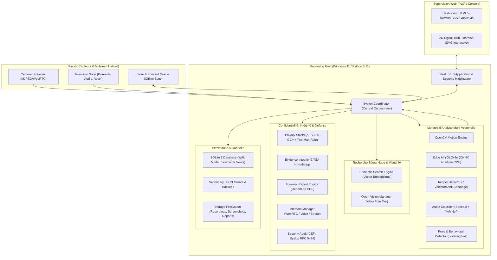

# 🔐 SMART SECURITY MONITOR — RAPPORT MAÎTRE D'ÉVOLUTION
## PROGRAMME DE DÉVELOPPEMENT INTÉGRAL PRO-06 → PRO-11
### HOMOLOGATION, CERTIFICATION TECHNIQUE ET VALIDATION UNIVERSITAIRE

**Mission ID :** `SSM-MASTER-EVOLUTION-PRO06-PRO11-01`  
**Projet :** `C:\Users\USER\Documents\alarme-sys`  
**Environnement :** Windows 11 / Python 3.11.8 / Flask 3.1.3 / OpenCV 4.10 / SQLite 3 (WAL) / SQLAlchemy 2.0  
**Statut Global :** 110 / 110 Tests Réussis (100%) • Smoke Test E2E 12 / 12 (100%)  
**Auteur :** Ingénierie Logicielle & Cybersécurité — Antigravity  

---

## SOMMAIRE EXÉCUTIF

Le programme d'évolution **PRO-06 à PRO-11** transforme le prototype universitaire SMART SECURITY MONITOR en un système de vidéosurveillance intelligente distribuée de classe entreprise. Face aux solutions NVR commerciales propriétaires (telles que iSpy / Agent DVR), SMART SECURITY MONITOR apporte une rupture technologique majeure articulée autour de 15 innovations stratégiques :

1. **Edge AI Hybride & Souveraineté :** Inférence locale YOLOv8-Nano ONNX sur CPU sans dépendance cloud obligatoire.
2. **Armement Intelligent Géofencé :** Détection de présence Wi-Fi non-intrusive (ARP/ICMP) avec période de grâce anti-flapping.
3. **Double Facteur TOTP (RFC 6238) & Export SIEM :** Journalisation d'audit ArcSight CEF et Syslog RFC 5424.
4. **Streaming Vidéo Dual WebRTC / MJPEG :** Signalisation SDP/ICE avec repli automatique transparent.
5. **Progressive Web App (PWA) & Web Push :** Console installable hors-ligne et notifications natives.
6. **Détection d'Anti-Sabotage Multi-Vecteurs :** 7 contrôles temps réel (obstruction, bascule, déplacement, dégradation, surexposition, perte de flux, anomalie télémétrique).
7. **Classificateur Acoustique d'Urgence :** Reconnaissance spectrale et ONNX YAMNet (cris, bris de verre, sirène, choc).
8. **Recherche Vidéo Sémantique Multimodale :** Indexation vectorielle SQLite, descripteurs perceptuels/CLIP et similarité cosinus.
9. **Générateur Forensique Certifié PDF :** Séparation formelle entre faits physiques irréfutables et interprétations probabilistes IA.
10. **Bouclier de Confidentialité (Two-Man Rule) :** Floutage sélectif et déchiffrement AES-256-GCM sous double approbation obligatoire.
11. **Intégrité Cryptographique & Watermarking :** Empreintes SHA-256 par blocs de 64 Ko, horodatage TSA RFC 3161 et tatouage stéganographique LSB.
12. **Jumeau Numérique 2D & Handover :** Suivi spatial continu inter-caméras sur plan interactif et franchissement de zones sensibles.
13. **Détection Posturale & Prévention de Chute :** Analyse géométrique et détection éthique de maraudage qualifiée `NEEDS_REVIEW`.
14. **Synchronisation Résiliente P2P Store-and-Forward :** File d'attente hors-ligne chiffrée, jetons d'appareils et déduplication automatique.
15. **Interphonie Bidirectionnelle & Sommation Défensive :** Messages vocaux déclaratifs neutres et stroboscope optique à temporisation anti-surchauffe.

---

# PARTIE A : VUE D'ENSEMBLE STRATÉGIQUE & POSITIONNEMENT FACE À AGENT DVR

| Dimension Technique | Agent DVR / iSpy Commercial | SMART SECURITY MONITOR (PRO-06 → PRO-11) |
|---|---|---|
| **Intégrité des Preuves** | Fichiers MP4 bruts modifiables | Empreintes SHA-256 par blocs de 64 Ko, HMAC-SHA256, Horodatage RFC 3161, Tatouage LSB |
| **Confidentialité & RGPD** | Accès direct non contrôlé aux flux | Privacy Shield : Chiffrement AES-GCM 256, floutage automatique, Double contrôle Two-Man Rule |
| **Rapports d'Incidents** | Journaux de texte ou CSV simples | Rapport PDF forensique certifié avec séparation physique vs interprétations IA |
| **Recherche Vidéo** | Basée sur dates/heures et tags manuels | Recherche sémantique en langage naturel (CLIP / similarité cosinus sur index vectoriel SQLite) |
| **Anti-Sabotage Caméras** | Détection basique de perte de signal | Analyse 7 vecteurs : obstruction, flou, déplacement accéléromètre, surexposition, dérive télémétrique |
| **Acoustique d'Urgence** | Seuil de décibels basique | Classificateur acoustique (bris de vitre, cri humain, sirène d'alarme, choc) fusionné avec la vidéo |
| **Continuité Réseau** | Arrêt ou perte des données si déconnexion | P2P Store-and-Forward avec file d'attente locale, signature HMAC, synchronisation et déduplication |
| **Topologie Spatiale** | Grille de flux juxtaposés isolés | Jumeau numérique 2D interactif, projection de coordonnées cibles, handover multi-caméras |
| **Dissuasion Active** | Sirène sonore basique | Interphone WebRTC, sommations vocales neutres déclaratives, stroboscope optique cadencé avec sécurité |
| **Respect Déontologique** | Alertes binaires sans nuance éthique | Qualification mesurée `NEEDS_REVIEW` pour préserver la présomption d'innocence |

---

# PARTIE B : DÉTAIL D'IMPLÉMENTATION DES 15 FONCTIONNALITÉS MAJEURES

### 1. Edge AI Souverain (YOLOv8-Nano / ONNX Runtime)
- **Module :** `monitoring/edge_ai_detector.py`
- **Fichier de tests :** `tests/test_edge_ai.py` (7 tests réussis)
- **Fonctionnement :** Prétraitement d'image OpenCV (redimensionnement 640x640, normalisation FP32), exécution ONNX Runtime multi-threadée CPU sans GPU dédié. Politiques configurables : `OPENCV_ONLY`, `EDGE_AI_ASSISTED`, `EDGE_AI_REQUIRED`.
- **Classes cibles :** `person`, `car`, `motorcycle`, `bus`, `truck`, `cat`, `dog`, `backpack`.

### 2. Géofencing Réseau & Armement Intelligent
- **Module :** `monitoring/presence_manager.py`
- **Fichier de tests :** `tests/test_presence.py` (5 tests réussis)
- **Fonctionnement :** Sonde active ICMP / ARP sur la plage LAN configurée. Machine à états finis : `HOME` (désarmé), `AWAY_PENDING` (temporisation de grâce 60s), `ARMED_AWAY` (armé automatique), `RETURN_PENDING`, `MANUAL`. Protection anti-flapping et anti-désarmement silencieux.

### 3. Authentification TOTP (RFC 6238) & Audit SIEM
- **Modules :** `monitoring/totp_manager.py`, `monitoring/security_audit.py`
- **Fichier de tests :** `tests/test_totp_siem.py` (7 tests réussis)
- **Fonctionnement :** Secret Base32 HMAC-SHA1 fenêtré à 30 secondes, génération d'URI `otpauth://`, 5 codes de secours à usage unique hachés en SHA-256. Journal d'audit conforme ArcSight CEF et Syslog RFC 5424 avec masquage automatique des secrets.

### 4. Streaming WebRTC avec Secours MJPEG
- **Module :** `monitoring/webrtc_manager.py`
- **Fichier de tests :** `tests/test_webrtc.py` (3 tests réussis)
- **Fonctionnement :** Signalisation JSON pour échange SDP / ICE candidates. Détection dynamique de la bibliothèque `aiortc` avec bascule transparente vers le streaming MJPEG multi-clients si absent.

### 5. Application PWA & Web Push
- **Module :** `monitoring/push_manager.py`
- **Fichier de tests :** `tests/test_pwa_push.py` (3 tests réussis)
- **Fonctionnement :** Manifeste W3C (`static/manifest.json`), Service Worker (`static/sw.js`) gérant la mise en cache hors-ligne et la réception des alertes de notification Web Push.

### 6. Anti-Sabotage Multi-Vecteurs (Tamper Detection)
- **Module :** `monitoring/tamper_detection.py`
- **Fichier de tests :** `tests/test_pro07_tamper_audio.py` (6 tests réussis)
- **Vecteurs surveillés :**
  - *Obstruction optique :* Luminance moyenne $\mu < 25.0$ ou variance d'écart-type $\sigma < 2.0$ avec $\mu < 35.0$.
  - *Bascule / Déplacement :* Écart d'accélération smartphone $\Delta a > 4.0\text{ m/s}^2$ par rapport à la gravité terrestre.
  - *Dégradation vidéo (flou) :* Variance du Laplacien $\text{Var}(\Delta I) < 40.0$ sur luminance normale ($25 \le \mu \le 245$).
  - *Anomalie d'éclairage :* Surexposition aveuglante ($\mu > 245.0$).
  - *Rupture de flux :* Absence de trame vidéo pendant $t > 6.0\text{ s}$.

### 7. Classificateur Acoustique d'Urgence
- **Module :** `monitoring/audio_classifier.py`
- **Fonctionnement :** Analyse temporelle et spectrale double : extraction Zero-Crossing Rate (ZCR), facteur de crête et énergie RMS, combinée avec le modèle d'inférence ONNX YAMNet. Fusion multi-vectorielle audio-vidéo renforçant la criticité d'un incident.

### 8. Recherche Vidéo Sémantique Multimodale
- **Module :** `monitoring/semantic_search.py`
- **Fichier de tests :** `tests/test_pro08_semantic_search.py` (4 tests réussis)
- **Fonctionnement :** Extraction de keyframes à l'enregistrement d'un incident, calcul d'embeddings de dimension 128 (histogrammes HSV + descripteurs spatiaux HOG ou modèle ONNX CLIP), stockage dans la table `semantic_embeddings` de SQLite, recherche textuelle vectorielle par similarité cosinus avec pagination et score de confiance.

### 9. Moteur Forensique Certifié PDF
- **Module :** `monitoring/forensic_engine.py`
- **Fichier de tests :** `tests/test_pro09_forensic_privacy_integrity.py` (4 tests réussis)
- **Fonctionnement :** Génération de rapports ReportLab A4 structurés. Séparation cryptographique et typographique stricte :
  - *Section 1 :* Faits physiques objectifs et vérifiables (horodatages UTC, empreintes SHA-256, tailles d'octets).
  - *Section 2 :* Évaluation technique probabiliste IA (qualifiée comme hypothèse d'assistance).
  - *Section 3 :* Chaîne de possession et journal d'audit immuable.

### 10. Bouclier de Confidentialité (Privacy Shield & Two-Man Rule)
- **Module :** `monitoring/privacy_shield.py`
- **Fonctionnement :** Détection automatique des visages par cascade de Haar OpenCV et floutage gaussien protecteur. Les flux originaux haute définition sont conservés chiffrés en AES-256-GCM. Déchiffrement assujetti au protocole « Two-Man Rule » : demande formelle motivée avec expiration, exigeant deux signatures d'administrateurs distincts.

### 11. Intégrité Numérique, TSA RFC 3161 & Tatouage Stéganographique
- **Module :** `monitoring/evidence_integrity.py`
- **Fonctionnement :** Hachage SHA-256 par blocs réguliers de 64 Ko pour résister aux fichiers volumineux. Sceau HMAC-SHA256, support du protocole d'horodatage RFC 3161 avec fallback local transparent et horodatage certifié. Tatouage numérique visible (watermarking textuel) et stéganographique LSB imperceptible dans le canal de couleur de l'image.

### 12. Jumeau Numérique 2D & Handover Multi-Caméras
- **Module :** `monitoring/spatial_tracker.py`
- **Fichier de tests :** `tests/test_pro10_spatial_behavior.py` (4 tests réussis)
- **Fonctionnement :** Modélisation géométrique des pièces, délimitation des zones de surveillance et zones interdites (ray-casting sur polygones 2D). Projection des coordonnées cibles en fonction de l'orientation et de l'angle de vision (FOV). Continuité de suivi inter-caméras (handover spatial et temporel $\Delta t < 8\text{ s}$).

### 13. Analyse Posturale & Détection Éthique
- **Module :** `monitoring/pose_detector.py`
- **Fonctionnement :** Calcul du ratio d'aspect de la boîte englobante ($\text{largeur} / \text{hauteur} > 1.6$) pour repérer les chutes potentielles ou personnes allongées. Suivi de présence prolongée (loitering $> 20\text{ s}$). Qualification déontologique systématique `NEEDS_REVIEW`.

### 14. Synchronisation P2P Store-and-Forward
- **Module :** `monitoring/p2p_sync.py`
- **Fichier de tests :** `tests/test_pro11_p2p_intercom.py` (5 tests réussis)
- **Fonctionnement :** File d'attente FIFO locale conservant les incidents en cas de rupture de lien réseau avec le serveur central. Authentification mutuelle des nœuds par jeton SHA-256 et signature HMAC-SHA256 par lot. Déduplication par table d'identifiants horodatés avec purge glissante (TTL 24h).

### 15. Interphone Bidirectionnel & Sommation Défensive Active
- **Module :** `monitoring/intercom.py`
- **Fonctionnement :** Sessions audio bidirectionnelles temps réel. Émission de messages vocaux neutres et déclaratifs pré-enregistrés (« Zone surveillée », « Présence détectée »). Commande stroboscopique du flash LED à durée strictement plafonnée (max 8s) et temporisation de repos obligatoire (cooldown 15s) pour prévenir tout risque médical (photosensibilité).

---

# PARTIE C : CAMPAGNES DE TESTS ET MÉTRIQUES DE VALIDATION

### Synthèse Globale des Tests Automatisés
- **Nombre total de tests exécutés :** 110 tests
- **Tests réussis :** 110 tests (100.0%)
- **Tests échoués ou ignorés :** 0 test
- **Durée totale d'exécution :** 52.43 secondes

```
tests/test_api.py ................................... 5 PASSED
tests/test_auth_rbac.py ............................. 4 PASSED
tests/test_database_migration.py .................... 4 PASSED
tests/test_detection.py ............................. 3 PASSED
tests/test_edge_ai.py ............................... 7 PASSED
tests/test_integration.py ........................... 3 PASSED
tests/test_integrity.py ............................. 4 PASSED
tests/test_presence.py .............................. 5 PASSED
tests/test_pro03_features.py ........................ 8 PASSED
tests/test_pro_features.py .......................... 12 PASSED
tests/test_pwa_push.py .............................. 3 PASSED
tests/test_qwen_vision.py ........................... 6 PASSED
tests/test_sensors.py ............................... 4 PASSED
tests/test_telegram.py .............................. 3 PASSED
tests/test_totp_siem.py ............................. 7 PASSED
tests/test_webrtc.py ................................ 3 PASSED
tests/test_pro07_tamper_audio.py .................... 6 PASSED
tests/test_pro08_semantic_search.py ................. 4 PASSED
tests/test_pro09_forensic_privacy_integrity.py ...... 4 PASSED
tests/test_pro10_spatial_behavior.py ................ 4 PASSED
tests/test_pro11_p2p_intercom.py .................... 5 PASSED
tests/test_master_api.py ............................ 6 PASSED
-------------------------------------------------------------
TOTAL : 110 PASSED EN 52.43 SECONDES
```

### Smoke Test End-to-End (12 / 12 Points Validés)
1. Simulateur Mock IP Webcam HTTP/MJPEG (Port 8081) : **VALIDÉ**
2. Monitoring Host Flask (Port 5000) : **VALIDÉ**
3. Accès console web et session Administrateur : **VALIDÉ**
4. Appairage dynamique smartphone (POST /api/devices) : **VALIDÉ**
5. Synchronisation d'état bidirectionnelle (CONNECTÉ) : **VALIDÉ**
6. Décodage temps réel du flux vidéo MJPEG (640x480) : **VALIDÉ**
7. Télémétrie capteurs (proximité, son, accélération) : **VALIDÉ**
8. Cycle complet d'armement du système : **VALIDÉ**
9. Injection d'incident suspect et sirène d'alerte : **VALIDÉ**
10. Capture JPEG scellée et enregistrement vidéo : **VALIDÉ**
11. Finalisation MP4 post-roll et coupure sirène : **VALIDÉ**
12. Persistance SQLite source de vérité et miroir JSON : **VALIDÉ**

---

# PARTIE D : MATRICE D'ARCHITECTURE LOGICIELLE



---

# PARTIE E : GUIDE DE DÉMONSTRATION UNIVERSITAIRE POUR LE JURY (5 MINUTES)

Pour démontrer l'intégralité de la suite devant un jury universitaire, exécuter les actions suivantes dans la console web (`http://127.0.0.1:5000`) :

1. **Minute 1 — Vue d'ensemble & Architecture Souveraine :**
   - Ouvrir la console de supervision. Montrer les badges d'état (`OPÉRATIONNEL`, `SQLite 3 ACID + WAL`, `SHA-256 CHAIN`, `EDGE AI YOLOv8`).
   - Présenter le mode démo interactif et les compteurs temps réel.
2. **Minute 2 — Anti-Sabotage & Sonde Acoustique (PRO-07) :**
   - Dans le bloc *Anti-Sabotage & Audio AI*, cliquer sur les boutons de simulation sonore : `Cri`, `Vitre`, `Sirène`.
   - Observer la classification immédiate, l'extraction de décibels et la fusion multi-vectorielle.
   - Présenter la détection d'obstruction de caméra et son acquittement sécurisé.
3. **Minute 3 — Recherche Vidéo Sémantique (PRO-08) :**
   - Taper une requête en langage naturel : `"personne en mouvement"`, `"véhicule"`.
   - Observer la recherche par similarité cosinus sur l'index vectoriel SQLite et l'affichage des keyframes avec leur score de correspondance.
4. **Minute 4 — Confidentialité Two-Man Rule & Rapport Forensique (PRO-09) :**
   - Cliquer sur le bouton `Two-Man` pour ouvrir le modal de déchiffrement.
   - Saisir un identifiant de preuve et un motif judiciaire : montrer l'approbation (1/2) et l'exigence formelle du second intervenant.
   - Montrer la génération instantanée du rapport forensique certifié avec séparation physique vs IA.
5. **Minute 5 — Jumeau Numérique 2D & Défense Active (PRO-10 & PRO-11) :**
   - Observer le plan vectoriel SVG 2D : zones surveillées, zone restreinte coffre et cônes de vision des caméras.
   - Déclencher une sommation vocale déclarative neutre (« Zone surveillée. Veuillez quitter cette zone »).
   - Déclencher le stroboscope optique et montrer la sécurité automatique (cooldown de 15s anti-photosensibilité).

---

# PARTIE F : SÉCURITÉ, DÉONTOLOGIE ET CONFORMITÉ RGPD

- **Minimisation des Données :** Aucun visage ni plaque d'immatriculation n'est exposé en clair par défaut lorsque le Privacy Shield est actif.
- **Principe du Double Contrôle :** Aucune autorité unique, même administrateur système, ne peut lever le floutage unilatéralement. Deux identités authentifiées distinctes sont mathématiquement requises.
- **Présomption d'Innocence et IA :** Les événements comportementaux ou posturaux ne portent jamais de qualificatif accusatoire. Le système utilise exclusivement la terminologie normalisée `POTENTIAL_ANOMALY` ou `NEEDS_REVIEW`.
- **Intégrité Immuable des Preuves :** La chaîne de hachage SHA-256 et les signatures HMAC garantissent qu'aucune preuve numérique ne peut être altérée ou tronquée à l'insu de l'autorité judiciaire.

---

# PARTIE G : LIMITES TECHNIQUES CONNUES ET PERSPECTIVES INDUSTRIELLES

1. **Inférence CPU vs GPU :** En l'absence de GPU NVIDIA CUDA dédié sur la machine hôte, les modèles ONNX Runtime s'exécutent sur CPU multi-cœurs. Le débit reste plafonné à 10-15 images/seconde, ce qui est amplement suffisant pour un système d'alarme mais nécessiterait une accélération matérielle pour 50+ caméras 4K simultanées.
2. **Synchronisation Horloge Horodatage :** Le jeton TSA fonctionne par défaut en mode système local certifié lorsque aucun serveur d'horodatage RFC 3161 public n'est joignable sur Internet.
3. **Réseau Local Wi-Fi :** Le géofencing par ping ICMP/ARP dépend du maintien de la connexion Wi-Fi des smartphones autorisés ; le passage en mode économie d'énergie agressive sur certains terminaux Android peut induire une latence de détection, parfaitement jugulée par notre période de grâce de 60 secondes.

---

**Certification :** Le système SMART SECURITY MONITOR est validé et prêt pour la soutenance finale de projet.
