# 🛡️ SMART SECURITY MONITOR (SSM) — PROGRAMME PRO-13
## SPÉCIFICATION D'ARCHITECTURE TECHNIQUE CIBLE (TARGET ARCHITECTURE)
### MASTER MISSION : `SSM-PRO13-MASTER-ARCHITECTURE-AND-IMPLEMENTATION-PROGRAM-01`

- **Document ID :** `SSM-PRO13-ARCH-SPEC-01`
- **Classification :** ARCHITECTURAL SPECIFICATION · DEFENSIVE ENGINEERING · INDUSTRIAL NVR · PRIVACY-BY-DESIGN
- **Version cible :** PRO-13.0
- **Dépôt :** `C:\Users\USER\Documents\alarme-sys`
- **Statut :** PROPOSÉ POUR VALIDATION (POINT D'ARRÊT PHASE 1)

---

## 1. VISION STRATÉGIQUE ET OBJECTIFS ARCHITECTURAUX

Le programme **PRO-13** a pour vocation de transformer *Smart Security Monitor* d'une application de supervision centrée sur les smartphones Android en une **plateforme universelle de sécurité vidéo, multimodale, cyber-résiliente et industriellement déployable**.

Cette mutation architecturale repose sur cinq principes directeurs non négociables :
1. **Séparation Stricte des Responsabilités (SoC) :** Découplage complet entre l'acquisition des flux, l'analyse IA, l'arbitrage décisionnel, le scellement forensique et l'actionnement physique.
2. **Préservation Intégrale des Acquis de Sécurité PRO-12 :** Aucune protection (anti-SSRF, RBAC, Two-Man Rule, Fail-Closed, HMAC, CSRF, chiffrement AES-256-GCM) ne peut être contournée ou affaiblie.
3. **Privacy-by-Design et Éthique RGPD :** Rejet inconditionnel de la biométrie faciale ; l'association inter-caméras repose exclusivement sur des descripteurs vestimentaires et contextuels non identifiants à durée de vie éphémère.
4. **Sécurité Physique Fail-Safe :** Aucune commande d'actionneur physique (verrouillage de porte, rideau métallique) ne peut être automatisée par défaut ni entraver les issues de secours.
5. **Déploiement Reproductible & Dégradation Gracieuse :** Fonctionnement garanti sur station Windows 11 hôte ou sous conteneurs Docker Linux multi-stage non-root, avec maintien de l'enregistrement classique même en cas de défaillance complète des couches IA ou réseau.

---

## 2. COMPARAISON ARCHITECTURALE : ÉTAT ACTUEL VS ÉTAT CIBLE PRO-13

```mermaid
graph TD
    subgraph "Architecture Actuelle (PRO-12)"
        A1[Smartphones Android IP Webcam] -->|HTTP /video & /sensors.json| B1[CameraWorker cv2.VideoCapture Synchrone]
        B1 --> C1[DetectionEngine OpenCV MOG2]
        C1 -->|Dictionnaires JSON non normalisés| D1[AlarmManager & RecordingManager]
        D1 --> E1[SQLite & Stockage Local]
    end

    subgraph "Architecture Cible PRO-13 (Modulaire en Couches)"
        A2[Sources Hétérogènes: RTSP, ONVIF Profile S/T, Android, USB, Simulateurs] -->|Abstraction VideoSource| B2[Couche d'Acquisition Asynchrone & Supervision Subprocess]
        B2 -->|Frames Timestampées & Tampon Ring| C2[Couche d'Analyse Indépendante AnalysisEngine]
        C2 -->|YOLO / Heuristiques / EPI / Fumée / Re-ID| D2[Bus d'Événements Normalisé SSMEVENT01]
        D2 -->|Déduplication & Persistance| E2[Couche Décisionnelle & Politique OBSERVE_ONLY par défaut]
        E2 --> F2[Couche Forensique: SHA-256 + HMAC + RFC3161 + OpenTimestamps]
        E2 --> G2[Couche d'Actionnement Sécurisée Fail-Safe: Relais, GSM Failover, WebAuthn]
        E2 --> H2[Supervision UX: Timeline 24h, Scrubbing & Heatmap Multimodale]
    end
```



---

## 3. LES SIX COUCHES ARCHITECTURALES PRO-13

### 3.1 Couche 1 : Acquisition Vidéo Universelle (`monitoring/acquisition/`)

L'acquisition est abstraite via l'interface générique `VideoSource` afin d'isoler l'application de tout protocole spécifique :

```python
from abc import ABC, abstractmethod
from typing import Optional, Tuple, Dict, Any
import numpy as np

class VideoSource(ABC):
    """Contrat d'interface abstrait pour toute source de flux vidéo."""
    
    @abstractmethod
    def connect(self) -> bool:
        """Établit la connexion avec la source vidéo (avec backoff exponentiel)."""
        pass

    @abstractmethod
    def read_frame(self) -> Tuple[bool, Optional[np.ndarray], float]:
        """Lit la dernière frame disponible de manière non-bloquante.
        Retourne : (succès, frame_numpy_bgr, timestamp_utc)
        """
        pass

    @abstractmethod
    def get_health(self) -> Dict[str, Any]:
        """Retourne la télémétrie de santé (statut, FPS réel, latence, pertes)."""
        pass

    @abstractmethod
    def close(self) -> None:
        """Libère proprement les descripteurs réseau et processus enfants."""
        pass
```

#### Adaptateurs prévus :
1. `RTSPVideoSource` : Décodeur robuste basé sur `FFmpeg` encapsulé dans un sous-processus isolé avec contrôle strict des arguments (aucun appel shell brut), gestion des timeouts de lecture et récupération automatique après redémarrage caméra.
2. `ONVIFVideoSource` : Client ONVIF Profile S/T utilisant `WS-Discovery` pour la détection réseau, l'extraction de l'URI RTSP et la gestion des capacités PTZ matérielles réelles.
3. `AndroidIPWebcamSource` : Préservation intégrale de l'adaptateur existant pour smartphone Android (compatibilité ascendante PRO-01 à PRO-12).
4. `USBVideoSource` : Capture directe de caméras UVC / DirectShow locales (sans passerelle réseau).
5. `MockVideoSource` : Simulateur synthétique pour les tests unitaires et d'intégration sans équipement physique.

#### Règle anti-SSRF impérative :
Toute URI de connexion (RTSP, HTTP, ONVIF) doit être soumise à `is_allowed_camera_target()` avant toute tentative de socket :
- Rejet immédiat des adresses de métadonnées cloud (`169.254.169.254`).
- Rejet des adresses IP publiques par défaut.
- Rejet du loopback `127.0.0.1` sauf si `ALLOW_LOOPBACK_SIMULATOR=True` en environnement de dev/test.
- Masquage systématique des credentials d'authentification (`user:password@`) dans l'ensemble des journaux d'audit.

---

### 3.2 Couche 2 : Moteurs d'Analyse Indépendants (`monitoring/analytics/`)

Chaque module d'analyse hérite de l'interface `AnalysisEngine` et s'exécute de façon autonome sans bloquer la boucle d'acquisition principale :

```python
class AnalysisEngine(ABC):
    """Contrat d'interface pour les moteurs de vision et d'analyse contextuelle."""
    
    @abstractmethod
    def initialize(self) -> bool:
        """Charge le modèle ou initialise les heuristiques de repli."""
        pass

    @abstractmethod
    def analyze(self, frame: np.ndarray, context: Dict[str, Any]) -> List["AnalysisResult"]:
        """Exécute l'analyse sur la frame et retourne les détections normalisées."""
        pass

    @abstractmethod
    def close(self) -> None:
        """Libère les ressources de calcul (sessions ONNX / tenseurs)."""
        pass
```

#### Structure de Données Normalisée `AnalysisResult` :
Chaque inférence produit un objet typé et sérialisable :
```python
@dataclass(frozen=True)
class AnalysisResult:
    engine_id: str             # ex: "reid_engine", "fire_detector", "ppe_checker"
    engine_version: str        # ex: "1.0.0-cpu"
    detection_type: str        # ex: "SMOKE_CANDIDATE", "PPE_NON_COMPLIANCE"
    confidence: float          # [0.0 - 1.0]
    bounding_box: Optional[Tuple[float, float, float, float]] # (x_min, y_min, x_max, y_max) normalisés [0.0 - 1.0]
    attributes: Dict[str, Any] # Métadonnées contextuelles (ex: {"color_hsv": [...], "zone": "Zone_Nord"})
    ethical_status: str        # "NEEDS_HUMAN_REVIEW", "OBSERVATION_ONLY"
    timestamp_utc: float
```

---

### 3.3 Couche 3 : Système Événementiel Normalisé (`monitoring/events/`)

Introduction d'un schéma d'événement universel **`SSMEVENT01`** commun à l'ensemble du système :

```json
{
  "schema_version": "SSMEVENT01",
  "event_id": "ev_20261122_8f29c4a1",
  "source_camera_id": "cam_hall_entree_01",
  "event_type": "PERSON_REIDENTIFICATION_CANDIDATE",
  "severity": "WARNING",
  "timestamp_utc": 1795325000.125,
  "confidence": 0.82,
  "decision_mode": "OBSERVE_ONLY",
  "evidence_hashes": [
    {
      "type": "JPEG_KEYFRAME",
      "sha256": "e3b0c44298fc1c149afbf4c8996fb92427ae41e4649b934ca495991b7852b855"
    }
  ],
  "payload": {
    "target_zone": "HALL_ACCUEIL",
    "signature_digest": "a9f82c4...",
    "review_status": "NEEDS_OPERATOR_APPROVAL"
  }
}
```

#### Principes du Bus Événementiel :
- **Idempotence & Anti-Rejeu :** Clé d'unicité `(source_camera_id, event_id)`.
- **Déduplication double niveau :** Cache glissant LRU en mémoire (10 000 éléments) + persistance SQLite avec contrainte d'intégrité.
- **Politique de rétention :** Expiration automatique configurable selon la sévérité (ex: 7 jours pour `INFO`, 30 jours pour `WARNING`, 90 jours pour `CRITICAL`).

---

### 3.4 Couche 4 : Moteur Décisionnel et Politique d'Actionnement (`monitoring/decision/`)

Le moteur décisionnel applique une séparation stricte entre **constat algorithmique** et **déclenchement physique**.

#### Les 4 Modes de Fonctionnement :
1. **`OBSERVE_ONLY` (Mode par défaut obligatoire) :** Enregistre les événements et génère des journaux d'audit sans aucune notification sonore ni action physique.
2. **`ALERT_ONLY` :** Génère des notifications dans le tableau de bord web, alertes push PWA et télégrammes d'information, sans actionnement matériel.
3. **`OPERATOR_APPROVAL` :** Toute action physique (sirène extérieure, relais matériel, envoi SMS de secours) requiert une confirmation explicite d'un opérateur connecté avec jeton CSRF valide.
4. **`CONTROLLED_AUTOMATION` (Mode hautement restreint) :** Permet des actions automatisées préalablement qualifiées et strictement temporisées (ex: stroboscope lumineux plafonné à 8 secondes, cooldown 15s).

#### Règles de Sécurité Physique Non-Négociables :
- **Verrouillage d'issues formellement interdit :** Aucune commande de verrouillage de portes, portiques ou rideaux métalliques ne peut être pilotée automatiquement par le système.
- **Fail-Safe matériel obligatoire :** En cas de coupure de courant ou de crash du logiciel, les relais doivent être câblés en sécurité positive (déverrouillage automatique mécanique pour l'évacuation).
- **Arrêt d'urgence matériel & logiciel (`Emergency Stop`) :** Endpoint protégé et bouton d'action directe coupant immédiatement l'ensemble des relais et des avertisseurs sonores.

---

### 3.5 Couche 5 : Chaîne de Preuve et Double Horodatage (`monitoring/forensics/`)

Le système de preuve numérique s'enrichit d'un double ancrage cryptographique :

1. **Intégrité Locale et Horodatage RFC 3161 (Préservé) :**
   - Hachage SHA-256 par blocs de 64 Ko sur l'original.
   - Sceau d'authenticité HMAC-SHA256 (`EVIDENCE_HMAC_KEY`).
   - Jeton d'horodatage délivré par une autorité TSA certifiée RFC 3161 (avec repli local traçable `UNCONFIRMED` en cas d'absence réseau).
2. **Ancrage Décentralisé OpenTimestamps (OTS - Lot E) :**
   - Agrégation périodique des empreintes des preuves dans un arbre de Merkle cryptographique.
   - Soumission de la racine de Merkle aux calendriers OpenTimestamps publics (ancrage final dans la blockchain Bitcoin sans frais de transaction).
   - Génération d'un fichier d'attestation `.ots` conservé dans `storage/evidence/`.
   - Distinguo strict des états de confirmation : `NOT_SUBMITTED`, `PENDING`, `STAMPED`, `VERIFIED`.

---

### 3.6 Couche 6 : Supervision Opérationnelle et Heatmap 24h (`templates/` & `static/js/`)

L'interface de supervision intègre un composant haute résolution de navigation temporelle :
- **Curseur de chronologie (Scrubbing 24h) :** Défilement fluide permettant de parcourir les événements sans recharger la page.
- **Heatmap multi-flux unifiée :**
  - Rouge : Détection humaine / intrus
  - Bleu : Alerte acoustique critique
  - Jaune : Mouvement volumétrique OpenCV
  - Orange : Candidat flamme / fumée (non certifié)
  - Violet : Violation de zone / Sabotage caméra
  - Vert : Présence autorisée / Reconnaissance EPI
- **Architecture de requêtage bornée :** L'API fournit des résumés temporels agrégés par blocs d'une heure (`/api/timeline/summary`) pour éviter d'inonder le navigateur avec des dizaines de milliers d'événements bruts.

---

## 4. DÉCOUPAGE DÉTAILLÉ DU PROGRAMME EN SEPT LOTS (LOTS A À G)

```mermaid
flowchart LR
    Phase0[Phase 0: Audit Initial Baseline] --> Phase1[Phase 1: Architecture Cible]
    Phase1 --> LotA[Lot A: NVR Universel & Découverte]
    LotA --> LotB[Lot B: Person Re-ID & Objets]
    LotB --> LotC[Lot C: Fumée, Flammes & EPI]
    LotC --> LotD[Lot D: Timeline & Heatmap]
    LotD --> LotE[Lot E: WebAuthn, Two-Man & OTS]
    LotE --> LotF[Lot F: Honeypot & Continuité GSM]
    LotF --> LotG[Lot G: Actionneurs & Docker]
    LotG --> AuditFinal[Phase 8: Audit Indépendant Final]
```



### 4.1 Lot A : NVR Universel & Découverte Réseau
- **Composants :** `RTSPVideoSource`, `ONVIFVideoSource`, module de découverte `WS-Discovery` et `mDNS`.
- **Garanties :** Validation anti-SSRF stricte, protection contre les URL RTSP malicieuses, isolation des sous-processus FFmpeg.
- **Livrable :** `docs/security/SSM_PRO13_A_NVR_REPORT.md`

### 4.2 Lot B : Intelligence Vidéo Contextuelle (Privacy-Preserving)
- **Composants :** `PersonReIdentifier` (basé sur histogrammes de couleurs HSV, ratios morphologiques, contexte temporel sans biométrie faciale), `AbandonedObjectDetector`, `RemovedAssetDetector`.
- **Garanties :** Rapprochements qualifiés de probabilités temporaires, expiration automatique des pistes, respect du RGPD.
- **Livrable :** `docs/security/SSM_PRO13_B_VIDEO_INTELLIGENCE_REPORT.md`

### 4.3 Lot C : Détection Spécialisée (Fumée, Flammes, EPI)
- **Composants :** Détecteur optique de panaches de fumée (dynamique temporelle et opacité), détecteur de lueurs de flammes, vérificateur de conformité EPI (casque, gilet) par zone.
- **Garanties :** Qualification explicite `POSSIBLE_SMOKE`/`POSSIBLE_FLAME` ; mention obligatoire qu'il ne s'agit pas d'un système de sécurité incendie homologué SSI.
- **Livrable :** `docs/security/SSM_PRO13_C_FIRE_PPE_REPORT.md`

### 4.4 Lot D : Supervision Forensique & Heatmap d'Activité
- **Composants :** Composant UI Timeline 24h, scrubbing vidéo synchronisé, agrégation d'événements par tranche horaire, heatmap d'activité colorée accessible.
- **Garanties :** Pagination stricte des requêtes, conservation de l'intégrité forensique lors des exports, traçabilité RBAC des consultations.
- **Livrable :** `docs/security/SSM_PRO13_D_FORENSIC_TIMELINE_REPORT.md`

### 4.5 Lot E : Authentification Forte & Ancrage Décentralisé
- **Composants :** Module d'authentification `WebAuthn` (FIDO2 / YubiKey / Passkeys) côté serveur, intégration de la validation matérielle dans le protocole Two-Man Rule, moteur d'ancrage `OpenTimestamps` (OTS).
- **Garanties :** Validation cryptographique complète des attestations WebAuthn côté serveur, préservation du scellement RFC 3161 existant.
- **Livrable :** `docs/security/SSM_PRO13_E_TRUST_AND_EVIDENCE_REPORT.md`

### 4.6 Lot F : Cyber-Résilience & Continuité GSM/LTE
- **Composants :** Module Honeypot défensif isolé (leurre RTSP/HTTP sans accès aux caméras réelles ni aux secrets), passerelle d'alerting cellulaire GSM/4G avec outbox persistante résistante aux redémarrages.
- **Garanties :** Leurre à surface minimale sans pivot réseau possible, basculement clair `PRIMARY_ONLINE` -> `FAILOVER_REQUESTED` -> `GSM_READY`.
- **Livrable :** `docs/security/SSM_PRO13_F_RESILIENCE_REPORT.md`

### 4.7 Lot G : Intégration Industrielle & Conteneurisation Docker
- **Composants :** Abstraction `Actuator` (relais série/USB/MQTT contrôlés), Dockerfile multi-stage minimaliste, `docker-compose.yml` multi-profils (CPU standard, OpenVINO, ONNX).
- **Garanties :** Utilisateur Docker non-root, aucun secret embarqué dans l'image, montage de volumes persistants sécurisés, interdiction formelle d'automatisation des issues de secours.
- **Livrable :** `docs/security/SSM_PRO13_G_INDUSTRIAL_DEPLOYMENT_REPORT.md`

---

## 5. STRATÉGIE DE MIGRATION DE LA BASE DE DONNÉES SQLITE

Pour préserver l'historique existant sans interruption de service :
1. **Extension non-destructrice des modèles SQLAlchemy :**
   - Ajout d'une colonne `source_type` (`ANDROID`, `RTSP`, `ONVIF`, `USB`) et `rtsp_uri` dans la table `devices`.
   - Création de la table `events_log` pour l'ingestion normalisée `SSMEVENT01`.
   - Création de la table `webauthn_credentials` pour l'enrôlement des clés FIDO2.
   - Création de la table `ots_anchors` pour la gestion des attestations OpenTimestamps.
2. **Migrations Idempotentes dans `database.py` :**
   - Vérification par `PRAGMA table_info` avant tout `ALTER TABLE`.
   - Maintien du mode `WAL` (*Write-Ahead Logging*) et du verrouillage `busy_timeout = 5000`.

---

## 6. MATRICE DES RISQUES ET POINTS DE CONTRÔLE DÉCISIONNELS

| Risque identifié | Niveau | Mesure d'atténuation architecturale |
|---|---|---|
| **Consommation CPU excessive lors du décodage multi-flux RTSP** | Élevé | Décodage à résolution adaptée (640x480), limitation à 10 FPS pour l'analyse, backoff exponentiel sur flux instables. |
| **Tentative de SSRF via injection d'URI RTSP malveillante** | Critique | Validation DNS stricte avant socket, filtrage des adresses privées/publiques, rejet des métadonnées cloud. |
| **Blocage d'issues de secours par un relais physique** | Catastrophique | **Interdiction de verrouillage automatique** ; exigences fail-safe matérielles ; arrêt d'urgence logiciel/physique. |
| **Perte de preuves lors d'une coupure Internet** | Modéré | Stockage local prioritaire en base SQLite relationnelle scellée ; horodatage TSA/OTS en différé asynchrone. |
| **Faux positifs sur les détections de fumée/flammes** | Modéré | Qualification `UNCONFIRMED` obligatoire ; confirmation visuelle opérateur requise avant toute alarme générale. |

---

## 7. CONCLUSION ET ENGAGEMENT D'ARRÊT DE LA PHASE 1

L'architecture cible présentée fournit un cadre rigoureux, modulaire et vérifiable pour l'ensemble du programme PRO-13.
Conformément aux instructions impératives de la mission :
- Aucun code des lots A à G n'a été produit prématurément.
- Les livrables d'audit forensique (`SSM_PRO13_0_INITIAL_FORENSIC_BASELINE.md`) et de spécification architecturale (`SSM_PRO13_TARGET_ARCHITECTURE.md`) sont achevés et vérifiables.
- Les travaux sont formellement suspendus dans l'attente de la revue et des directives de validation.
